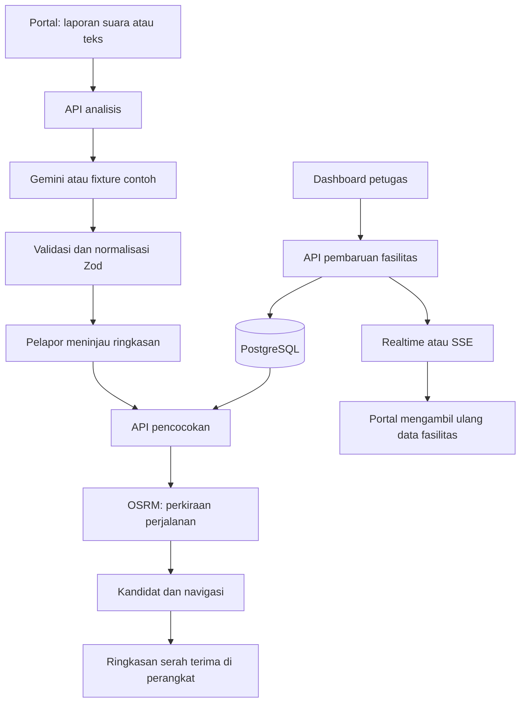

# Arsitektur RujukCepat

[Kembali ke README](../README.md)

RujukCepat menggunakan satu aplikasi Next.js dengan portal pelapor dan dashboard petugas. Server menangani pemanggilan penyedia, validasi, akses data, dan perubahan fasilitas. Database menjadi sumber kebenaran untuk kesiapan dan kuota.

## Aliran sistem

Ringkasan tidak dikirim ke rumah sakit. Pemilihan tujuan dan navigasi tidak membuat reservasi atau mengurangi kuota. Tabel dan fungsi rujukan dari rancangan awal tetap ada dalam migrasi untuk kompatibilitas database, tetapi tidak digunakan oleh alur aplikasi saat ini.

## Pembagian modul

| Direktori | Tanggung jawab |
| --- | --- |
| `src/app` | Halaman, metadata PWA, dan route handler API. |
| `src/components` | Antarmuka portal, dashboard, peta, dan suara. |
| `src/lib/schema` | Schema Zod serta tipe dan kode bersama. |
| `src/lib/ai` | Adapter Gemini, fixture contoh, prompt, dan normalisasi keluaran. |
| `src/lib/matching` | Penyaringan dan pemeringkatan fasilitas. |
| `src/lib/routing`, `src/lib/navigation` | Rute, petunjuk perjalanan, dan kemajuan navigasi. |
| `src/lib/data`, `src/lib/facilities` | Akses PostgreSQL dan data fasilitas. |
| `src/lib/auth`, `src/lib/sync` | Sesi petugas dan notifikasi perubahan. |
| `supabase` | Migrasi, seed, dan shim khusus database lokal. |
| `tests` | Pengujian unit, integrasi, dan fixture sintetis. |

## Ringkasan AI

Masukan audio atau teks diproses melalui server. Keluaran memuat laporan, SOAP, perkiraan urgensi, kebutuhan kapabilitas, informasi yang belum diketahui, dan kualitas masukan.

Setiap fakta membedakan pernyataan pelapor, interpretasi AI, dan informasi yang belum diketahui. Keluaran dinormalisasi dan divalidasi sebelum dipakai untuk pencocokan. JSON yang tidak valid dicoba ulang satu kali; jika tetap gagal, API menolak hasilnya. Kode kapabilitas ilegal disaring dan rencana yang memuat pola dosis dibuang.

Pada `AI_MODE=mock`, keluaran berasal dari fixture sintetis dan ditandai sebagai hasil contoh. Rekaman tidak dianalisis oleh Gemini. Pada `AI_MODE=live`, server menggunakan model yang diatur melalui `GEMINI_MODEL`. Kedua mode melalui jalur validasi yang sama.

## Delapan kapabilitas

| Kode | Layanan |
| --- | --- |
| `IGD_DASAR` | Layanan IGD dasar |
| `CATH_LAB` | Laboratorium kateterisasi jantung |
| `CT_SCAN` | Pemeriksaan CT scan |
| `ICU_VENTILATOR` | Perawatan intensif dengan ventilator |
| `PONEK_NICU` | Kegawatdaruratan obstetri dan neonatal |
| `TRAUMA_BEDAH` | Penanganan trauma dan bedah |
| `HEMODIALISA` | Layanan hemodialisis |
| `ANTI_BISA` | Layanan terkait antibisa |

## Pencocokan tujuan

1. Batasi pencarian berdasarkan `MATCH_MAX_KM`, yaitu radius jarak garis lurus.
2. Saring rumah sakit yang tidak memenuhi seluruh kebutuhan wajib: status harus READY, belum melewati `STALE_AFTER_MINUTES`, dan kuota tersedia harus lebih dari nol.
3. Ambil hingga `MATCH_MAX_ROUTED` fasilitas layak terdekat berdasarkan jarak garis lurus untuk dihitung rutenya.
4. Urutkan kandidat tersebut berdasarkan ETA yang tersedia, kebutuhan opsional yang terpenuhi, dan kuota. Kebutuhan opsional tidak mengubah syarat kelayakan.

Jika rute gagal, ETA dibiarkan kosong dan jarak garis lurus diberi label yang sesuai. Jika tidak ada kandidat, aplikasi menampilkan alasan tanpa melonggarkan kebutuhan wajib secara otomatis. Mode rute contoh memakai perkiraan dari jarak garis lurus dan tidak menyediakan petunjuk belok.

Kesiapan dan kapasitas dataset merupakan data contoh. Tag OpenStreetMap dan perkiraan jenis rumah sakit digunakan untuk menyusun seed, bukan untuk membuktikan kapabilitas klinis fasilitas.

## Data, akses, dan sinkronisasi

- **Lokal:** PGlite menjalankan migrasi PostgreSQL yang sama. SSE memberi tahu klien tentang perubahan dalam proses server yang sama.
- **Supabase:** server mengakses PostgreSQL melalui `pg`, lalu mengirim metadata perubahan ke kanal Supabase Realtime `rc:facilities`.
- **Pemulihan koneksi:** event memicu pengambilan ulang dari API. Klien mengambil ulang data setelah tersambung kembali dan memakai polling lima detik ketika koneksi terputus.
- **Petugas:** cookie sesi bertanda tangan mengikat petugas pada rumah sakitnya. Otorisasi berada di route server; aplikasi menggunakan sesi sendiri, bukan Supabase Auth. Fungsi mutasi database dibatasi untuk koneksi server.
- **Kuota:** hanya diperbarui petugas. Nilainya tidak boleh negatif atau melebihi kapasitas total.

## API utama

| Metode | Rute | Kegunaan |
| --- | --- | --- |
| `GET` | `/api/status` | Mode layanan dan konfigurasi publik aplikasi. |
| `GET` | `/api/facilities` | Data fasilitas yang boleh ditampilkan ke portal. |
| `POST` | `/api/analyze` | Memproses laporan dengan persetujuan pengguna. |
| `POST` | `/api/match` | Menyaring dan mengurutkan pilihan tujuan. |
| `GET` | `/api/route` | Menghitung rute ke rumah sakit pilihan. |
| `POST` | `/api/staff/login`, `/api/staff/logout` | Membuka dan menutup sesi petugas. |
| `GET` | `/api/staff/me` | Memeriksa sesi petugas. |
| `PATCH` | `/api/facilities/:id` | Memperbarui fasilitas milik petugas yang masuk. |
| `GET` | `/api/stream` | SSE pada mode lokal. |
| `POST` | `/api/demo/reset` | Mengembalikan data contoh; khusus admin dan memerlukan konfirmasi. |

## Pemrosesan dan privasi data

Audio dan teks dikirim ke server aplikasi. Pada mode live, keduanya diteruskan ke Google Gemini. Koordinat dipakai oleh layanan pencocokan/rute; koordinat bukan masukan analisis Gemini pada implementasi ini. Penyedia peta menerima permintaan tile dan OSRM menerima koordinat rute.

Aplikasi tidak menyimpan audio, transkrip, atau ringkasan pasien di database. Ringkasan berada dalam memori halaman dan hilang ketika laporan dihapus atau halaman ditutup/dimuat ulang. Ketentuan pemrosesan penyedia eksternal tetap berlaku; lihat [atribusi dan layanan](ATTRIBUTIONS.md).

Service worker hanya menyimpan aset statis, ikon, dan halaman offline. Respons API, laporan, kapasitas, dan HTML aplikasi tidak dijadikan cache offline. Mode offline tidak menampilkan keberhasilan operasi yang belum dikonfirmasi server.
